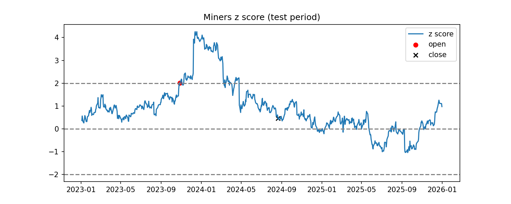
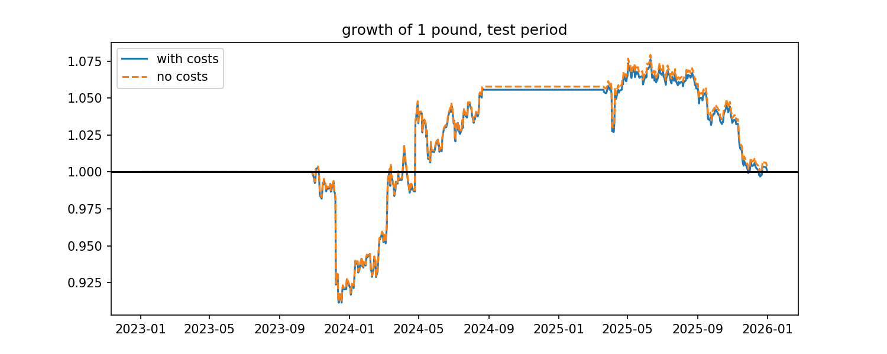

# Pairs trading on UK stocks

Two stocks can move up and down on the same days for years and still drift completely apart. This project is about telling those pairs apart from the ones that actually stay together, and testing whether you can make money from the difference.

## The question

Some companies are pushed around by the same forces, so their share prices tend to move together. Lloyds and NatWest both live off UK interest rates, Tesco and Sainsbury's both depend on what people spend on food, and BP and Shell both follow the oil price. When the gap between two of these stocks opens up, you can sell the one that has run ahead and buy the one that has fallen behind, then close both once they come back together.

I wanted to know whether that bet would have made money once trading costs are included. To keep the answer honest, I made every decision using data up to the end of 2022, then judged the strategy only on 2023 to 2025, as if I had been trading it live.

## Data

I used daily prices from Yahoo Finance through `yfinance`, from January 2016 to December 2025, adjusted for dividends and share splits so that a dividend payment does not look like a sudden fall in price.

| Pair | Stocks |
|---|---|
| UK banks | Lloyds (LLOY.L), NatWest (NWG.L) |
| Oil majors | BP (BP.L), Shell (SHEL.L) |
| Supermarkets | Tesco (TSCO.L), Sainsbury's (SBRY.L) |
| Insurers | Aviva (AV.L), Legal & General (LGEN.L) |
| Miners | Rio Tinto (RIO.L), Anglo American (AAL.L) |
| Country funds | Australia (EWA), Canada (EWC) |

I split the data into a build period (2016 to 2022), which I used to choose the pairs and set every number in the strategy, and a test period (2023 to 2025), which I only touched at the very end. All six pairs had a full price history, so none were dropped.

## Method

**Choosing the pairs.** For each pair I measured the correlation of daily returns and ran the Engle and Granger cointegration test on the log prices over the build period. Correlation only tells you whether two stocks move on the same days, whereas cointegration tells you whether the gap between them keeps coming back to the same level, and that is the property the whole strategy relies on. I kept pairs with a p value below 0.05.

**The hedge ratio.** Two related stocks rarely move by exactly the same amount, so I regressed log price A on log price B to get the hedge ratio β. This tells me how much of B to hold against each unit of A so that their shared movement cancels out and only the gap is left.

**The signal.** The spread is log A minus β times log B. I turned it into a z score, which measures how unusual today's gap is compared with normal, using the mean and standard deviation from the build period only.

**The rules.** When the z score rises above +2 the gap is unusually wide, so I short the spread by selling A and buying B. When it falls below −2 I do the opposite. I close the position once the z score comes back inside ±0.5, as by then the gap is effectively back to normal.

**The backtest.** I ran these rules on 2023 to 2025 with every number fixed from the build period. Each trade happens the day after the signal, since you only know the closing price once the market has closed, and each trade costs 0.1% per stock. I then averaged the pairs into one equally weighted portfolio.

## Results

**Pair selection (2016 to 2022)**

| Pair | Return correlation | Cointegration p value | Kept |
|---|---|---|---|
| UK banks | 0.80 | 0.909 | No |
| Oil majors | 0.90 | 0.151 | No |
| Supermarkets | 0.45 | 0.054 | No |
| Insurers | 0.81 | 0.800 | No |
| Miners | 0.81 | 0.004 | Yes |
| Country funds | 0.84 | 0.048 | Yes |

This table makes the point better than any explanation could. BP and Shell had the highest correlation of any pair at 0.90, and the banks and insurers were both above 0.80, yet none of them were cointegrated. Their prices moved on the same days, but the gap between them drifted rather than coming back. Only two of the six pairs passed. The supermarkets missed by a whisker with a p value of 0.054, but I kept the 0.05 cut off rather than moving the goalposts after seeing the result.

**Test period performance (2023 to 2025)**

| | Total return | Sharpe ratio | Max drawdown | Trades |
|---|---|---|---|---|
| Portfolio, with costs | 0.08% | 0.04 | −9.1% | 2 |
| Portfolio, no costs | 0.38% | 0.05 | −9.1% | 2 |
| Miners only | 10.11% | 0.32 | −17.8% | 1 |
| Country funds only | −10.33% | −0.62 | −14.3% | 1 |





Over the three test years the strategy broke even, returning 0.08% after costs with a Sharpe ratio of 0.04. It only traded twice, once for each pair, and the two trades almost exactly cancelled each other out.

The miners trade is the one worth looking at. It opened in late 2023 when the z score passed +2, but instead of closing, the gap kept widening to above +4 and the position fell almost 18% before recovering and closing in profit in 2024. The country funds trade lost about 10%. Trading costs were not the issue, as they only took the return from 0.38% to 0.08%.

The real finding is that the relationships did not hold. Pairs that looked tightly linked on 2016 to 2022 data behaved very differently afterwards, and with only two trades in three years the result says very little either way.

## Limitations

* **Hand picked pairs.** I chose the six candidates myself, so the starting list already reflects what I knew about which companies are similar.
* **Very few trades.** Two trades in three years is far too small a sample to judge the strategy fairly.
* **Simple costs.** A flat 0.1% per stock leaves out the bid and ask spread, market impact and the cost of borrowing shares to short them. It also ignores the 0.5% stamp duty on buying UK shares, which professional traders usually avoid by trading through contracts for difference.
* **Fixed relationships.** The hedge ratio and the normal level of the spread are set once from 2016 to 2022. Relationships between companies change due to takeover bids, mergers and shifts in strategy, and the model has no way of noticing when that happens.
* **No stop loss.** The miners trade moved from a z score of 2 to above 4 before it came back. A real trader would usually cut a position that moves that far against them, in case the relationship has broken for good.

## What I would do next

* Screen a much wider set of stocks for cointegrated pairs instead of choosing six by hand, so the strategy has far more chances to trade.
* Recalculate the hedge ratio and z score on a rolling window so they can adapt as relationships change.
* Add a stop loss, for example closing the trade if the z score passes ±4.
* Test how sensitive the results are to the entry level and the trading cost.

## Takeaway

A strong correlation looked convincing for five of these six pairs, and it would have been easy to stop there. Testing for cointegration cut the list down to two, and testing those two on data the model had never seen showed that even they were not reliable. That is the lesson I take from this project. Two stocks moving together is not the same as two stocks staying together.

## How to run

```
python3 -m pip install -r requirements.txt
python3 pairs_trading.py
```

The first run downloads the prices to `data/prices.csv`, and later runs load that file instead. The results tables and charts are saved to `results/`.
